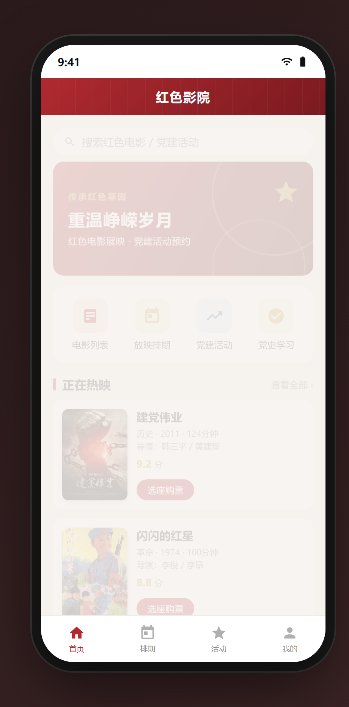
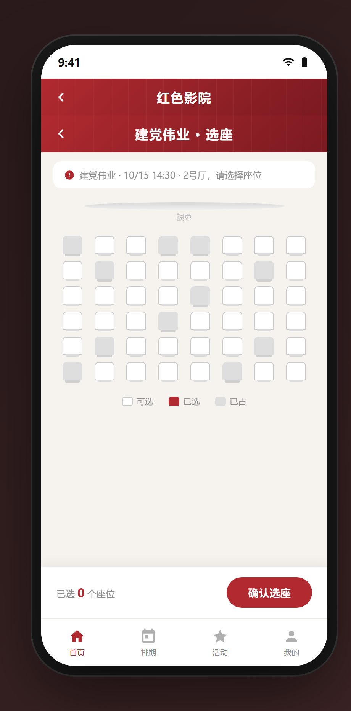

# 红色影院小程序

一个红色主题的微信小程序界面原型，把「红色电影」和「党建活动」装进一个 App：在线看排片、选座预约、党建活动报名、党史内容学习。

> 本项目是**高保真可交互界面原型**（单文件 HTML，双击即可在浏览器里点着玩），用于展示微信小程序的界面与交互流程。完整的小程序源码（微信原生 + 云开发）另行维护。

## 界面预览

| 首页 | 放映排期 | 在线选座 |
|:---:|:---:|:---:|
|  |  |  |

| 党建活动 | 个人中心 |
|:---:|:---:|
|  |  |

## 功能

- **红色电影列表**：真实电影数据（片名 / 导演 / 年份 / 时长 / 评分），搜索与分类
- **放映排期**：影片场次、日期切换、剩余座位数
- **在线选座**：银幕视角座位图，可选 / 已选 / 已占三态，实时统计已选座位
- **党建活动报名**：主题党日、观影会、宣讲会等，报名进度与「已满员」状态
- **党史内容展示**：图文列表 + 详情
- **个人中心**：电影预约、活动报名、学习时长

## 技术栈

- 小程序：微信原生（WXML + WXSS + JS）
- 后端：微信云开发（云数据库 + 云函数 + 云存储）
- 原型：单文件 HTML + CSS + 原生 JS

## 运行

原型为纯 HTML 单文件，无需构建，直接用浏览器打开：

```bash
open index.html
```

或将仓库部署到 GitHub Pages（设置 → Pages → 选择 `main` 分支根目录）即可在线预览。

## 目录结构

```
.
├── index.html            # 可交互界面原型
├── images/               # 海报与活动配图
│   ├── jiandangweiye.jpg
│   ├── shanshanhongxing.jpg
│   ├── changzheng.jpg
│   ├── act_watching.jpg
│   ├── act_lecture.jpg
│   └── act_oath.jpg
├── screenshots/          # 界面截图
└── README.md
```

## 说明

- 电影海报与部分配图来自公开图库，仅作界面演示用途，版权归原作者所有。
- 原型中的座位并发逻辑（条件更新防抢占）见博客文章《红色影院小程序》。
